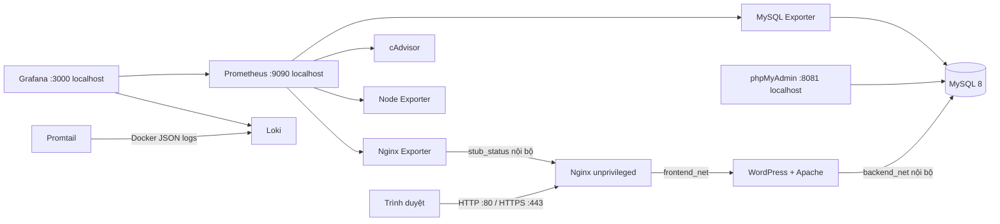

# Đề 3 — Website quảng bá sản phẩm bằng WordPress

**Môn học:** Triển khai và Quản trị Hệ thống Phần mềm  
**Sinh viên:** Quách Minh Hiếu · **MSSV:** DTC245010044 · **Email:** dtc245010044@ictu.edu.vn

Bản bài làm và báo cáo cũng nằm trong thư mục `Bai_lam_De3_WordPress/`.

## Mục tiêu và sản phẩm

Triển khai website WordPress tiếng Việt giới thiệu thương hiệu cà phê đặc sản Việt Nam **Nương**. Trang chủ có nội dung thương hiệu, danh mục sản phẩm, câu chuyện nguồn gốc, hướng dẫn pha và liên hệ. Sản phẩm là loại nội dung riêng trong WordPress, có thể tạo và sửa từ trang quản trị; mỗi sản phẩm lưu giá, vùng trồng, hương vị và nhãn nổi bật. Ba sản phẩm mẫu được tạo tự động ở lần cài đặt đầu.

## Kiến trúc



Các mạng Compose tách luồng truy cập: `frontend_net` nối proxy với ứng dụng; `backend_net` là mạng `internal` cho WordPress, phpMyAdmin, MySQL và exporter; `monitoring_net` dành cho Prometheus, Grafana, Loki, Promtail và các exporter. Cổng MySQL, Loki, exporter và Node Exporter không được publish ra máy chủ.

## Đối chiếu yêu cầu đề bài

| Tiêu chí | Phần đáp ứng trong dự án |
|---|---|
| Quản lý mã nguồn và hướng dẫn | Repository gồm cấu hình Compose, theme WordPress, cấu hình Nginx, Prometheus, Grafana, Loki, Promtail, mẫu `.env` và README triển khai. |
| Website, CSDL và công cụ quản trị | WordPress + MySQL 8; phpMyAdmin chỉ bind vào `127.0.0.1:8081`; tạo tài khoản quản trị WordPress và 3 sản phẩm mẫu tự động. |
| Reverse proxy và bảo mật web | Nginx unprivileged, chuyển HTTP sang HTTPS, chứng chỉ self-signed, security headers và giới hạn upload. |
| Giám sát | Prometheus thu thập số liệu container, máy chủ, Nginx và MySQL; Grafana có datasource và dashboard được provision tự động. |
| Tập trung log | Promtail đọc Docker JSON logs, gửi tới Loki; Grafana có truy vấn LogQL mẫu và bảng log trong dashboard. |
| Biện pháp bảo mật | Không publish DB/Loki/exporter; mạng DB nội bộ; tài khoản ứng dụng và exporter riêng; mật khẩu lấy từ `.env`; giới hạn CPU/RAM/PID; dịch vụ chạy non-root khi phù hợp. |
| Báo cáo, cài đặt và vận hành | README có sơ đồ, cấu hình, hướng dẫn khởi chạy, endpoint, truy vấn giám sát, vận hành, xử lý lỗi và danh sách ảnh minh chứng cần chụp. |

## Thành phần chính

- `docker-compose.yml` — dịch vụ, mạng tách biệt, volume dữ liệu, giới hạn tài nguyên và logging.
- `wordpress/themes/moc-may/` — giao diện responsive tiếng Việt và loại nội dung sản phẩm có thể quản trị trong WordPress.
- `wordpress/init-site.sh` — cài WordPress, kích hoạt giao diện, đặt múi giờ/permalink và tạo sản phẩm mẫu ở lần đầu.
- `mysql/init/10-create-exporter-user.sh` — tạo người dùng chỉ đọc số liệu cho MySQL exporter khi khởi tạo volume CSDL mới.
- `nginx/` — reverse proxy HTTPS, security headers, chứng chỉ minh họa và endpoint `stub_status` chỉ dùng trong mạng Docker.
- `prometheus/`, `grafana/` — scrape targets, datasource và dashboard provision sẵn.
- `loki/`, `promtail/` — lưu log cục bộ, đọc Docker JSON logs và gửi đến Loki.

## Cài đặt trên máy chạy Docker

Yêu cầu Docker Engine và Docker Compose v2. Trên máy chạy demo local, sao chép mẫu cấu hình:

```bash
cp .env.example .env
```

Tài khoản demo mặc định là `admin / admin123@` cho WordPress, phpMyAdmin và Grafana; MySQL root là `root / admin123@`. Đây là thông tin demo, chỉ dùng local. Trước khi mở hệ thống ra Internet, thay mật khẩu bằng các chuỗi ngẫu nhiên riêng trong `.env`. Mật khẩu `MYSQL_EXPORTER_PASSWORD` nên giữ dạng chữ/số hex để tránh ký tự nháy đơn trong câu lệnh khởi tạo SQL. File `.env` thật đã được loại khỏi Git.

Chứng chỉ hiện tại dùng cho demo tại `localhost` và `127.0.0.1`. Nếu cần tạo lại chứng chỉ cho máy local:

```bash
openssl req -x509 -nodes -days 365 -newkey rsa:2048 \
  -keyout nginx/certs/selfsigned.key \
  -out nginx/certs/selfsigned.crt \
  -subj "/CN=localhost" \
  -addext "subjectAltName=DNS:localhost,IP:127.0.0.1"
```

Giữ khóa ở quyền chỉ đọc cần thiết cho UID Nginx trong container; đây chỉ là khóa demo self-signed, không tái sử dụng cho tên miền công khai.

Khởi chạy toàn bộ stack:

```bash
docker compose pull
docker compose up -d
docker compose ps
docker compose logs -f wordpress-init
```

Lần đầu, `wordpress-init` chờ WordPress và MySQL, cài website, tạo tài khoản quản trị và thêm sản phẩm mẫu. Mở các trang sau sau khi dịch vụ đã khởi động:

| Dịch vụ | Địa chỉ | Đăng nhập |
|---|---|---|
| Website | [https://localhost](https://localhost) | — |
| Quản trị WordPress | [https://localhost/wp-admin](https://localhost/wp-admin) | `WP_ADMIN_USER` / `WP_ADMIN_PASSWORD` trong `.env` |
| phpMyAdmin | [http://127.0.0.1:8081](http://127.0.0.1:8081) | `MYSQL_USER` / `MYSQL_PASSWORD` trong `.env` |
| Prometheus | [http://127.0.0.1:9090](http://127.0.0.1:9090) | — |
| Grafana | [http://127.0.0.1:3000](http://127.0.0.1:3000) | `GRAFANA_ADMIN_USER` / `GRAFANA_ADMIN_PASSWORD` trong `.env` |

Trình duyệt sẽ cảnh báo chứng chỉ HTTPS tự ký; đây là điều bình thường cho môi trường bài tập. Không dùng chứng chỉ và khóa minh họa này cho website công khai. Các trang quản trị, Prometheus và Grafana chỉ bind vào loopback. Nếu cần truy cập từ máy khác, dùng SSH tunnel hoặc thay đổi bind address sau khi giới hạn truy cập bằng firewall.

## Quản trị website

Trong WordPress Admin, mở **Sản phẩm → Thêm sản phẩm cà phê**. Nhập tên, mô tả, tóm tắt; trong hộp **Thông tin sản phẩm**, điền giá, vùng trồng, ghi chú hương vị và nhãn. Sản phẩm đã publish sẽ xuất hiện trên trang chủ. Có thể đổi tên site trong **Settings → General**; logo chữ trên giao diện dùng tên site.

Thông tin WordPress, MySQL và Grafana trong `.env` chỉ được áp dụng khi tạo dữ liệu lần đầu. Đổi giá trị trong `.env` sau khi cài đặt không tự đổi mật khẩu đã lưu trong MySQL/WordPress/Grafana; cần đổi mật khẩu trong từng dịch vụ hoặc tạo lại dữ liệu.

## Kiểm tra giám sát và LogQL

Dashboard **WordPress · Hạ tầng** được nạp tự động trong Grafana, gồm CPU/RAM container, kết nối Nginx, MySQL uptime, tốc độ truy vấn và log container. Prometheus scrape mỗi 15 giây các job `prometheus`, `cadvisor`, `node-exporter`, `nginx` và `mysql`.

Trong **Grafana → Explore → Loki**, thử các truy vấn:

```logql
{job="docker"}
{job="docker"} |= "error"
{job="docker", container_id=~".+"} |~ "(?i)warning|failed|timeout"
```

Log giữ theo chính sách JSON log của Docker (tối đa 3 file, 10 MB mỗi file cho từng container). Promtail đọc `/var/lib/docker/containers`; môi trường Docker rootless hoặc Docker Desktop có thể dùng đường dẫn log khác nên cần chỉnh mount volume tương ứng. Promtail cần quyền đọc log host; cAdvisor cũng có quyền truy cập host/cgroup để thu thập metrics container.

Đề bài yêu cầu Promtail, nên stack giữ collector này cho phần trình diễn. Grafana đã kết thúc hỗ trợ Promtail từ ngày 02/03/2026; với hệ thống tiếp tục vận hành lâu dài, hãy thay nó bằng Grafana Alloy theo [hướng dẫn di chuyển chính thức](https://grafana.com/docs/grafana-cloud/send-data/alloy/set-up/migrate/from-promtail/).

## Bảo mật và vận hành

- Nginx dùng image unprivileged; Prometheus và Grafana cấu hình chạy với UID không phải root. MySQL/WordPress dùng entrypoint của image chính thức và hạ quyền cho tiến trình ứng dụng sau bước khởi tạo. Promtail chạy root để đọc file log Docker trên host; cAdvisor cần quyền host/cgroup để quan sát container.
- Mật khẩu thật đặt trong `.env`, không commit file này. MySQL không mở cổng host; WordPress dùng user ứng dụng riêng; exporter dùng tài khoản `exporter` chỉ có quyền đọc số liệu cần thiết.
- `backend_net` là mạng nội bộ; cổng giám sát riêng không public; PHPMyAdmin, Prometheus và Grafana bind mặc định vào `127.0.0.1`.
- CPU, RAM và số PID được giới hạn theo dịch vụ; container log được xoay vòng để tránh tăng vô hạn.
- Self-signed TLS mã hóa kết nối nhưng không tạo xác thực CA tin cậy. Khi triển khai công khai, thay chứng chỉ bằng chứng chỉ hợp lệ, đặt `SITE_URL` theo domain và sửa `server_name` trong `nginx/nginx.conf`.

Dữ liệu được lưu trong các named volumes `db_data`, `wp_data`, `grafana_data`, `prometheus_data`, `loki_data` và `promtail_positions`. Lệnh `docker compose down` dừng stack và giữ dữ liệu. Lệnh `docker compose down -v` xóa các volume dữ liệu và đưa hệ thống về trạng thái cài mới.

**Lưu ý khi nâng cấp từ volume MySQL đã có sẵn:** MySQL chỉ chạy file trong `mysql/init/` khi tạo volume rỗng. Nếu volume cũ chưa có user `exporter`, hãy tạo tài khoản đó một lần trong MySQL với quyền `PROCESS`, `REPLICATION CLIENT`, `SELECT`, hoặc dùng dữ liệu mới cho bài nộp.

## Minh chứng nên chụp khi nộp bài

1. Trang chủ WordPress và danh sách sản phẩm mẫu.
2. `docker compose ps` thể hiện các dịch vụ đang chạy.
3. Grafana dashboard có metrics Nginx, MySQL, container và bảng log.
4. Grafana Explore chạy được truy vấn LogQL.
5. Prometheus → **Status → Targets** hiển thị các job ở trạng thái `UP`.
6. phpMyAdmin hiển thị database WordPress và các bảng.
